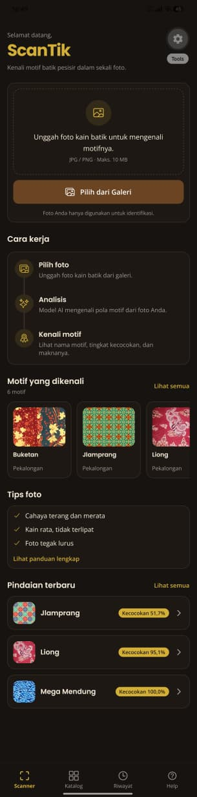
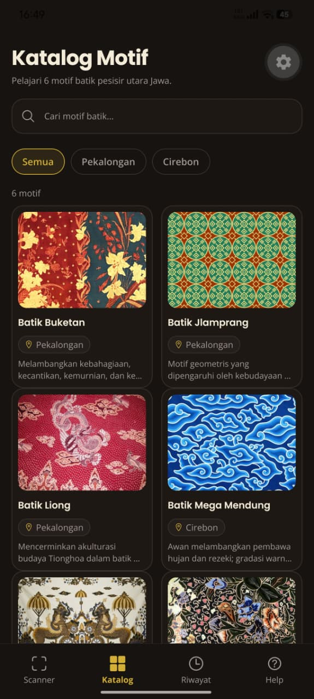
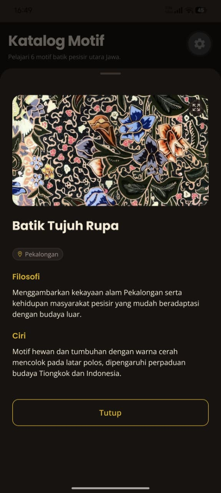
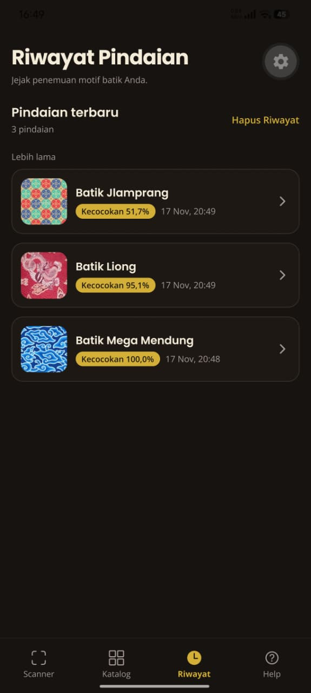
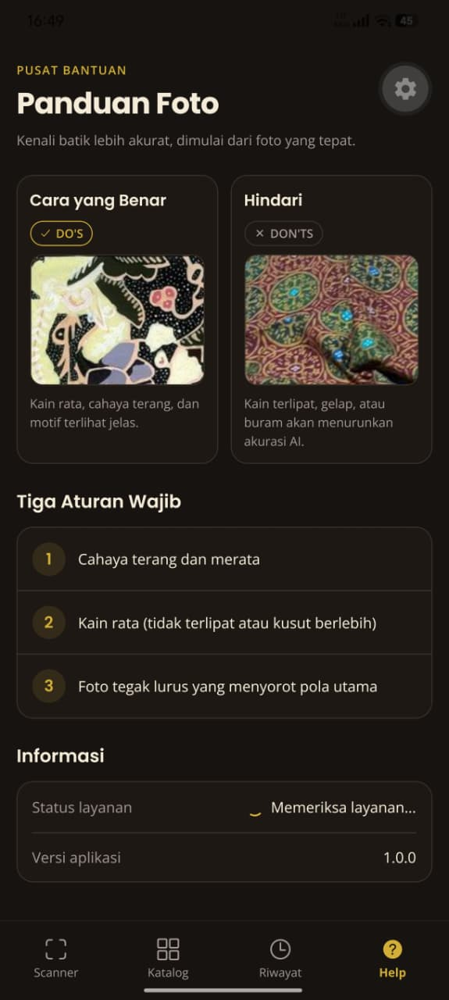
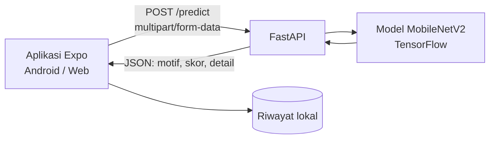

<div align="center">

# ScanTik Pekalongan

**Kenali motif batik pesisir utara Jawa dari satu foto.**

Aplikasi mobile edukasi budaya berbasis *machine learning* yang mengidentifikasi motif batik dari foto galeri, lalu menampilkan nama motif, tingkat kecocokan, serta makna dan sejarahnya.


</div>

---

## Daftar Isi

- [Tentang Proyek](#tentang-proyek)
- [Fitur](#fitur)
- [Tangkapan Layar](#tangkapan-layar)
- [Motif yang Dikenali](#motif-yang-dikenali)
- [Arsitektur](#arsitektur)
- [Teknologi](#teknologi)
- [Memulai](#memulai)
- [Konfigurasi API](#konfigurasi-api)
- [Struktur Proyek](#struktur-proyek)
- [Model Machine Learning](#model-machine-learning)
- [Batasan](#batasan)
- [Repositori Terkait](#repositori-terkait)
- [Pengembang](#pengembang)

## Tentang Proyek

ScanTik Pekalongan membantu wisatawan dan pelajar mengenali motif batik tanpa perlu tahu kata kunci pencarian terlebih dahulu. Pengguna cukup memilih foto kain batik dari galeri; foto dikirim ke REST API yang menjalankan model klasifikasi, dan hasilnya ditampilkan lengkap dengan penjelasan budaya.

Proyek ini dibuat sebagai tugas akhir (UAS) mata kuliah Pemrograman Berbasis Platform. Aplikasi berjalan di **Android** dan **web**.

## Fitur

- **Pindai dari galeri**: pilih foto batik (JPG/PNG, maks 10 MB); foto dikompres di sisi klien sebelum dikirim.
- **Hasil identifikasi**: nama motif, skor kecocokan, serta filosofi dan ciri motif. Skor di bawah 60% memunculkan peringatan agar pengguna mengikuti panduan foto.
- **Katalog motif**: 6 motif dengan foto, pencarian, filter asal (Pekalongan/Cirebon), dan detail lengkap yang bisa diperbesar.
- **Riwayat pindaian**: tersimpan lokal di perangkat, lengkap dengan thumbnail, skor, dan tombol hapus riwayat.
- **Panduan foto**: contoh foto yang benar dan yang perlu dihindari, tiga aturan wajib, serta status layanan API.
- **Antarmuka gelap** dengan aksen emas, responsif untuk HP dan desktop web.

## Tangkapan Layar

<table>
  <tr>
    <td align="center"><br><sub><b>Scanner</b></sub></td>
    <td align="center"><br><sub><b>Katalog</b></sub></td>
    <td align="center"><br><sub><b>Detail motif</b></sub></td>
    <td align="center"><br><sub><b>Riwayat</b></sub></td>
    <td align="center"><br><sub><b>Bantuan</b></sub></td>
  </tr>
</table>

## Motif yang Dikenali

| Motif | Asal |
| :--- | :--- |
| Buketan | Pekalongan |
| Jlamprang | Pekalongan |
| Liong | Pekalongan |
| Tujuh Rupa | Pekalongan |
| Mega Mendung | Cirebon |
| Singa Barong | Cirebon |

Foto di luar enam motif ini diklasifikasikan sebagai **Negatif** ("motif tidak dikenali").

## Arsitektur



1. Pengguna memilih foto dari galeri.
2. Aplikasi mengompres dan mengubah ukuran foto.
3. Foto dikirim ke endpoint `POST /predict`.
4. Model menghasilkan probabilitas per kelas; API mengembalikan motif, skor, dan detail.
5. Aplikasi menampilkan hasil dan menyimpannya ke riwayat lokal.

## Teknologi

| Lapisan | Teknologi |
| :--- | :--- |
| Aplikasi | React Native, Expo, Expo Router, TypeScript |
| Penyimpanan lokal | AsyncStorage (localStorage di web) |
| API | Python, FastAPI, TensorFlow (CPU) |
| Model | MobileNetV2 *transfer learning* (Keras), dilatih di Google Colab |
| Deploy API | Docker, Railway |

## Memulai

### Prasyarat

- [Node.js](https://nodejs.org/) versi LTS
- Aplikasi **Expo Go** di HP Android, atau emulator Android
- API yang sedang berjalan (lihat [Konfigurasi API](#konfigurasi-api))

### Instalasi

```bash
git clone <URL-repositori-ini>
cd scantik-app
npm install
```

### Menjalankan

```bash
npx expo start -c
```

- Tekan `a` untuk Android, atau pindai kode QR dengan Expo Go.
- Tekan `w` untuk membuka versi web.

> Opsi `-c` membersihkan cache; wajib setiap kali mengubah berkas `.env`.

## Konfigurasi API

Alamat API dibaca dari variabel lingkungan. Buat berkas `.env` di akar proyek:

```env
EXPO_PUBLIC_API_URL=https://alamat-api-anda
```

- Tulis alamat **tanpa garis miring di akhir**; aplikasi menambahkan `/predict` dan `/health` sendiri.
- API lokal untuk HP fisik: gunakan IP laptop di jaringan yang sama, misalnya `http://192.168.x.x:8000`.
- API yang di-*deploy* sebaiknya memakai `https`.

### Kontrak endpoint

| Endpoint | Metode | Fungsi |
| :--- | :--- | :--- |
| `/health` | GET | Cek status layanan |
| `/predict` | POST | Terima gambar (`file`, `multipart/form-data`), kembalikan prediksi |

Contoh respons `/predict` yang berhasil:

```json
{
  "status": "success",
  "data": {
    "predicted_class": "Buketan",
    "confidence_score": 98.72,
    "confidence_decimal": 0.9872,
    "motif_details": {
      "name": "Batik Buketan",
      "origin": "Pekalongan",
      "philosophy": "...",
      "characteristics": "..."
    }
  },
  "timestamp": "2026-11-22T09:09:24Z"
}
```

## Struktur Proyek

```
scantik-app/
├── assets/
│   └── images/
│       ├── motifs/          # foto 6 motif
│       └── help/            # contoh foto di tab Bantuan
├── docs/
│   └── screenshots/         # tangkapan layar untuk README
└── src/
    ├── app/                 # rute Expo Router
    │   ├── (tabs)/          # Scanner, Katalog, Riwayat, Bantuan
    │   └── result.tsx       # layar hasil klasifikasi
    ├── components/          # MotifCard, MotifSheet, ImageLightbox, dll.
    ├── config/              # alamat API
    ├── data/                # data motif dan foto motif
    ├── services/            # klien API (predict, health)
    ├── state/               # state aplikasi
    ├── storage/             # penyimpanan riwayat
    ├── theme/               # warna dan tipografi
    └── types/               # tipe TypeScript
```

## Model Machine Learning

- **Arsitektur:** MobileNetV2 dengan *transfer learning*.
- **Kelas:** 7 (Buketan, Jlamprang, Liong, Mega Mendung, Singa Barong, Tujuh Rupa, Negatif).
- **Dataset:** Kaggle *Batik Pesisir Utara Jawa with Negative Class V2*, dibagi per kelompok foto agar tidak terjadi kebocoran antar-split.

| Split | Jumlah gambar | Akurasi |
| :--- | ---: | ---: |
| Latih | 2.585 | 98,8% |
| Validasi | 738 | 93,2% |
| Uji | 369 | 92,4% |

Kode pelatihan dan API ada di repositori terpisah (lihat bawah).

## Batasan

- Model dilatih pada gaya foto tertentu; foto di luar gaya tersebut (misalnya foto contoh katalog) dapat diprediksi **Negatif** dengan skor tinggi.
- Recall terendah ada pada motif Liong.
- Hanya 6 motif yang dikenali.
- Layanan API di hosting gratis dapat tertidur saat tidak dipakai, sehingga permintaan pertama bisa lebih lambat.
- Di luar cakupan: kamera langsung, login, e-commerce, peta, fitur sosial, dan ML di perangkat.

## Repositori Terkait

- **API dan model:** [Bim44a/scantik-api](https://github.com/Bim44a/scantik-api)

## Pengembang

**Bima Adi Nugroho**
